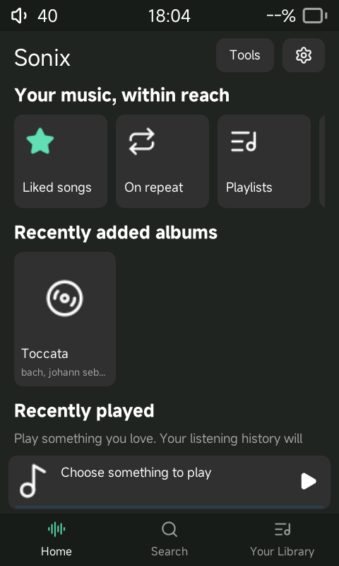
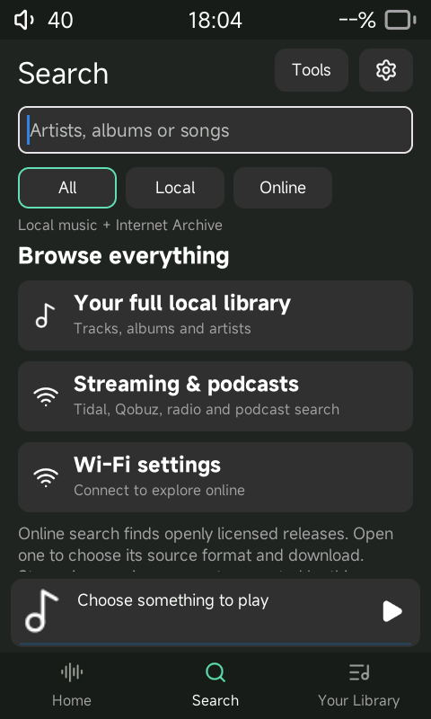
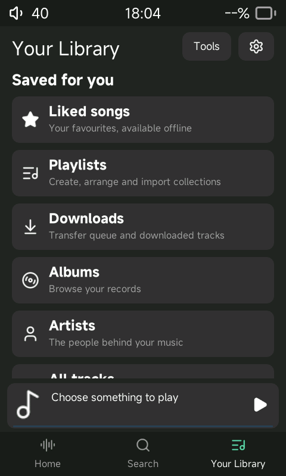
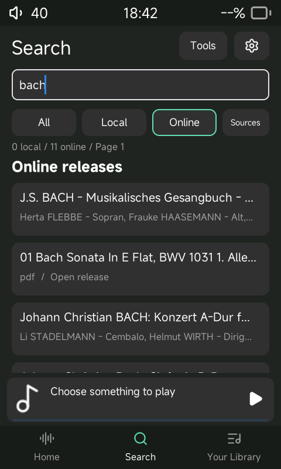
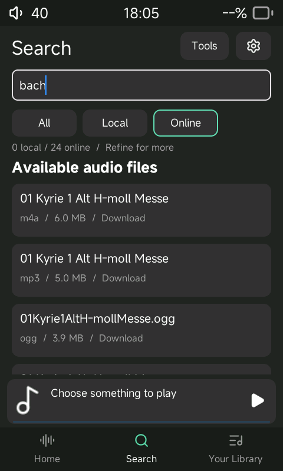
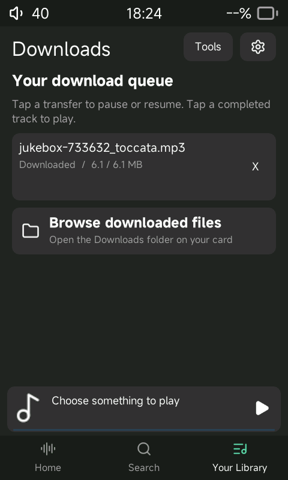

# R1 native discovery development fork

This is an implemented, testable development branch, **not a production firmware
release**. It adds a native LVGL shell, offline queue/library systems and an authorized download path to Sonix.
The latest-board kernel/radio compatibility and physical-device acceptance
criteria remain blocked. No device has been flashed and no `r1.upt` is supplied.

Baseline: `Jepl4r/sonix-player@fe94fe796d93c6efa50d1107a734864c9c6a03d5`.
Fork: [Alephx0/sonix-player](https://github.com/Alephx0/sonix-player), branch
`feature/r1-discovery`. Original Sonix code and licensing remain in place.

The [shared collection update](shared-collections.md) unifies album and playlist
browsing and adds a repeatable native simulator regression harness. Current UI
rules are consolidated in [UI_SPEC](../UI_SPEC.md), [DESIGN_SYSTEM](../DESIGN_SYSTEM.md),
[UI_TEST_MATRIX](../UI_TEST_MATRIX.md), and [UI_DECISIONS](../UI_DECISIONS.md).

The latest offline integration adds separate priority/context queues, playlist
membership, saved/pinned collections and indexed lyric search. See the
[offline player guide](offline-player.md) for controls, evidence and remaining scope.

The [organized Library update](organized-library.md) adds dedicated playlist management,
metadata-only folders, library search and selectable individual artists.

The [Home and player update](home-dashboard.md) adds an offline dashboard,
vertical Now Playing transition, integrated utility controls and conditional lyrics.

## Implemented workflow

1. Home offers recent listening, recently added albums, favourites and playlists.
2. Search has All / Local / Online filters and the native touch keyboard.
3. Online finds Internet Archive releases with explicit supported public licences;
   Previous/Next browses more results within fixed memory bounds.
4. Open a release, browse its creator's releases, or tap an available audio format
   to enqueue its source file. Results returns to the preceding catalog page.
5. Your Library > Downloads shows progress, pause/resume, retry, cancel and play.
6. A completed, checksum-verified file is imported into the existing local library.
   Existing embedded tags are retained; missing title/artist/album use an attribution
   sidecar. The original audio bytes are preserved and can be decoded offline.

Search > Sources exposes provider capabilities, an online-search toggle, a
persisted preferred-format order and a pause-all-transfers action. The new Sonix
Now Playing layout uses centered artwork, white transport controls and green active states;
it is the default for a fresh 480×800 configuration. Existing saved layout choices
are respected, and Music settings offers all four arrangements.

Tools exposes all six former top-level destinations. Existing Standard,
waveform and Studio layouts, streaming integrations and audio controls remain
in the source. Their full hardware behavior has **not** been regression-certified.
This fork does not implement a Spotify service client.

## Evidence and guides

- [Organized Library and individual artists](organized-library.md)

- [Offline Home and vertical player](home-dashboard.md)
- [Sliding panels, visual search and discography](sliding-panels.md)
- [Screenshot-based UI update](reference-ui.md)
- [Offline player features, controls and evidence](offline-player.md)
- [Architecture and interfaces](architecture.md)
- [Build, test and maintenance commands](development.md)
- [Test results and performance limits](test-report.md)
- [Original and requested feature matrix](feature-matrix.md)
- [Hardware, packaging blocker, installation and recovery status](hardware-and-packaging.md)
- [REA / SpotBye / Mornye investigation](reference-investigation.md)

## Simulator screenshots

Actual 480 × 800 SDL/LVGL captures; no browser mockup. Empty collections reflect
the small test library. Screenshots are a layout check, not a hardware test.

| Home | Search | Library |
|---|---|---|
|  |  |  |

| Online releases | Source formats | Downloads |
|---|---|---|
|  |  |  |

Also captured: [keyboard](screenshots/keyboard.png),
[provider settings](screenshots/provider-settings.png), and
[Sonix Now Playing](screenshots/now-playing.png). Artwork-test screenshots use
original synthetic geometric art, not artwork supplied by the audio provider.
The original [Standard](screenshots/standard-player.png),
[Waveform](screenshots/waveform-player.png) and [Studio](screenshots/studio-player.png)
arrangements were also captured with this fixture.

New live-path captures: [artist releases](screenshots/artist-releases.png),
[catalog page two](screenshots/page-two.png), and
[touch-initiated completed download](screenshots/touch-transfer-indexed.png).
The touch download's size, checksum and automatic library import are asserted
in [its test output](evidence/touch-download-test.log).

## Remaining product work

The feature matrix is the authoritative scope ledger. In particular, online
artist profiles/biographies, independent track/playlist search, remote artwork caching,
streaming previews, multiple-provider selection/fallback, configurable Home
shortcuts and translations of new strings
are incomplete. SpotBye dynamic network tracing needs an isolated Windows VM.
Hardware testing, prolonged playback/download stress and latest-board recovery
are still required. Do not interpret successful host tests or MIPS compilation
as completion of the original production-firmware acceptance criteria.
