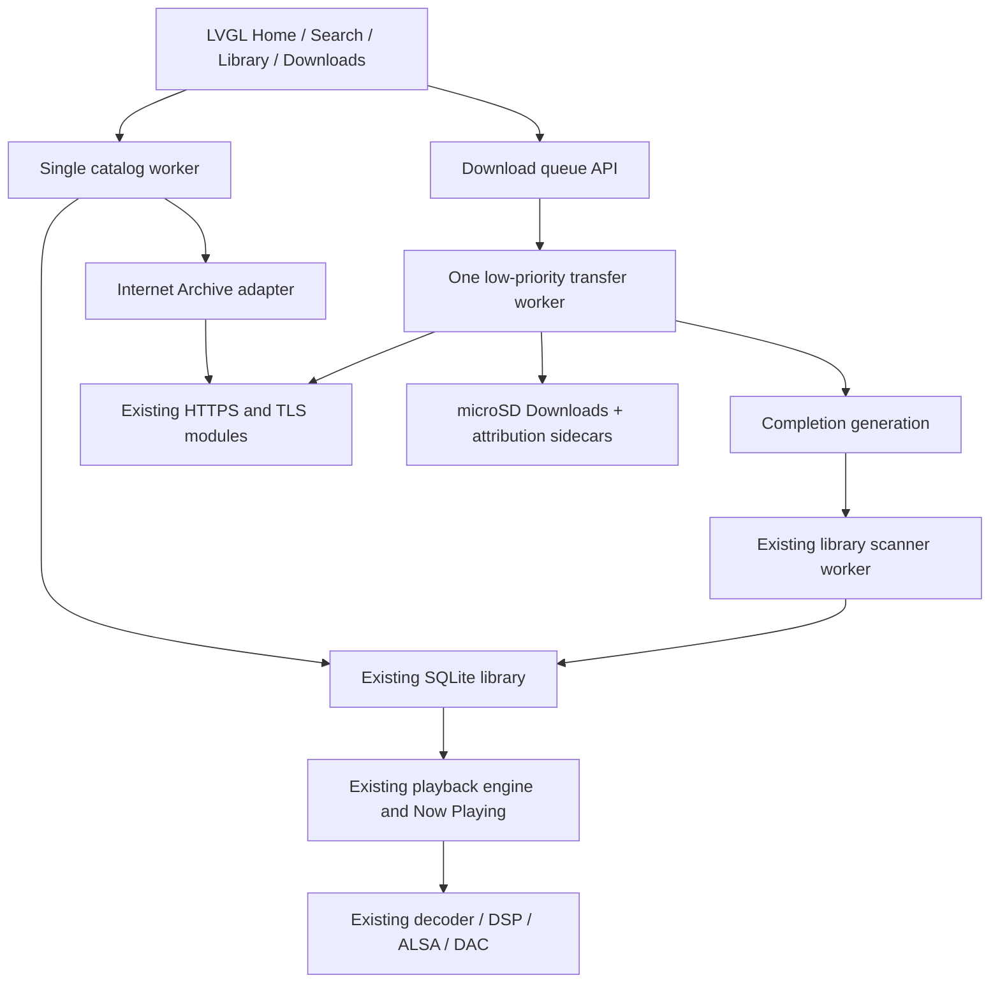

# Architecture

## Boundaries

`gui/shell/main_menu.c` owns primary-page widgets, navigation and result display.
Pages and the keyboard are constructed lazily. Catalog work runs off the LVGL
thread, publishes bounded results under a mutex, and is rendered by a UI timer.
Only one catalog request may be active. Primary tabs share a mini-player; legacy
pages keep their existing transport/navigation. New strings currently use English.

Home history queries fetch at most 24 rows for six unique recent tracks. Four
album thumbnails use existing asynchronous coverloader slots at 112 px and are
released when Home is hidden. The mini-player requests a 52 px copy of existing
player artwork. No additional full-resolution remote artwork is retained.
Thumbnail keys now include the parent directory modification time, so an absent
cover cached before `cover.png` arrives does not remain absent indefinitely.
In-place edits to an existing cover with unchanged directory timestamps still
depend on the existing cache-refresh behavior; no full directory scan was added
to every thumbnail cache hit.

The fourth Now Playing arrangement (Sonix) resizes the existing artwork widget
into an inset square, adds a missing-art card and heading, and reuses all original
transport, favourite, queue and lyrics callbacks. It allocates no second decoded
sleeve. Its layout choice is persisted alongside the three existing choices;
only fresh 480×800 configurations default to it. The existing artwork-accent
setting can override its mint accent using the already-computed album tone.

## Provider contract

`system/discovery/discovery.h` exposes provider name, capability bits, release
search, creator release lists, paged release audio listing and validated item structures. The current adapter
is a single native implementation, not a runtime extension loader. Another
provider must explicitly implement its supported operations and associated
validation; unsupported streaming/artist-biography/playlist operations are not advertised.

Search > Sources stores `discovery.enabled` and `discovery.format` in the existing
configuration. Disabled discovery reduces All to local search and refuses new
online requests. MP3/FLAC preference stably reorders available source variants,
within each page, without hiding alternatives or changing their bytes. Disabling search does not
silently cancel requested downloads; the settings page has an explicit pause-all
action. No fallback registry or authentication UI is implied by this single adapter.

Search uses [Archive advanced search](https://archive.org/advancedsearch.php)
with an escaped literal title/creator query. Release files come from the
[metadata API](https://archive.org/developers/md-read.html).
Each page inspects at most 24 candidate releases; policy filtering can leave fewer
results, including an empty page with more candidates available. Next/Previous
requests use stable identifier ordering and pages 1–1000. Artist releases search
the source creator phrase, which may represent multiple contributors rather than
a canonical artist identity. A release's Results button returns to its catalog
query and page. There is no global track ranking or search suggestion service.
Release metadata is limited to 256 KiB; excessive data returns a clear failure.
Its validated audio variants are paged locally in groups of 24; each page fetches
the bounded metadata again. Result structures are bounded to 24 entries.
IDs, filenames, file sizes, digest and source URL are
validated before a file is accepted into the queue.

Allowed licence URLs are explicit Creative Commons CC0/public-domain mark,
CC BY or CC BY-SA forms. Missing, unrecognised, restricted and private sources
are rejected. This relies on source-supplied metadata and does not independently
establish an uploader's rights. No service credentials or DRM mechanisms are used.
The UI exposes original source formats; no transcoding or quality inflation occurs.

## Download state and persistence

Eight jobs share one worker with a 256 KiB stack and 16 KiB transfer buffer.
The worker requests Linux nice 10. Network and checksum work never run in an LVGL
event handler. Queue snapshots and state changes are mutex-protected. A separate
lifecycle mutex serializes startup and shutdown around hotplug/USB transitions.

`Queued -> Downloading -> Downloaded` is the success path. Pause and cancellation
wake active socket reads. Transient transfers get three attempts with interruptible
1/2-second delays. Exhaustion becomes Failed; retry is explicit. Cancel removes
partial bytes. Restored non-cancelled jobs are Paused so removable-card data cannot
start network requests merely by insertion; resuming a completed file verifies
its digest before returning to Downloaded. Completed/cancelled slots can be reused
when the bounded queue fills.

Persistence lives in `Downloads/.sonix-downloads.json`. Directory descriptors,
`O_NOFOLLOW`, card inode/device checks and sanitized basenames constrain writes.
Transfers reserve 1 MiB free space, validate HTTPS status/length/ranges, preserve
partial offsets and verify the source MD5 incrementally before commit. MD5 is
an integrity check supplied over verified HTTPS, not a cryptographic authorship
proof. Metadata requests and download redirects reject HTTPS downgrades.

Finalization uses `renameat2(RENAME_NOREPLACE)` so concurrent file creation cannot
be overwritten. Old Rockbox headers lack this syscall constant; the o32 fallback
comes from [Linux 4.4's MIPS syscall table](https://raw.githubusercontent.com/torvalds/linux/v4.4/arch/mips/include/uapi/asm/unistd.h).
An unsupported device/card driver fails safely and retains the verified partial
file; actual FAT/exFAT behavior needs hardware validation.

After commit, `<audio>.source.json` retains provider metadata and attribution.
The library reader only fills missing embedded title/artist/album fields from a
bounded, regular, non-symlink sidecar with the matching byte count. Existing `.tags`
overrides remain authoritative. This is sidecar enrichment, not embedded retagging.

## Library and device integration

A completion generation is polled once per second. Each missing completed file
is passed to `library_import_download()` through the existing scanner worker and
transaction/index path. It does not enable Detect changes or prune other tracks.
A busy or closed library defers import. Round-robin selection prevents a removed
or undecodable file from starving later completions. Unindexed attempts wait 60
idle-scanner polls before retry; a new completion starts a fresh sweep. The
generation remains pending until every current completed file is in the index.
The import scheduler has a separate deterministic regression. The library import regression uses the real host objects
and verifies duplicate suppression, existing-track retention and reopen persistence.

Card detach and USB storage export join the transfer worker before releasing
storage; active transfers count as Wi-Fi use for the existing idle policy.
Shutdown during DNS/connect/TLS setup can wait for existing network timeouts;
instant cancellation and a fully asynchronous device-detach path are not claimed.
The host's SD root now follows `SONIX_SD_ROOT` rather than target mount probing.

No decoder, DSP algorithm or hardware driver was replaced. Mornye/SpotBye supplied
design observations only; their runtimes and application code were not copied.

## Offline playback and organization

The new native modules and their storage/resource limits are documented in
[offline-player.md](offline-player.md). `playlist.c` owns separate priority,
context and playback-history state; all touchscreen and physical transport
routes still use `device_state.c`. `collectionview.c` edits the existing playlist
library while `collections.c` stores saved/pinned metadata. `search_index.c`
adds bounded word posting lists to the same SQLite music index. Search workers
return data for the LVGL thread to render; they never manipulate widgets.
