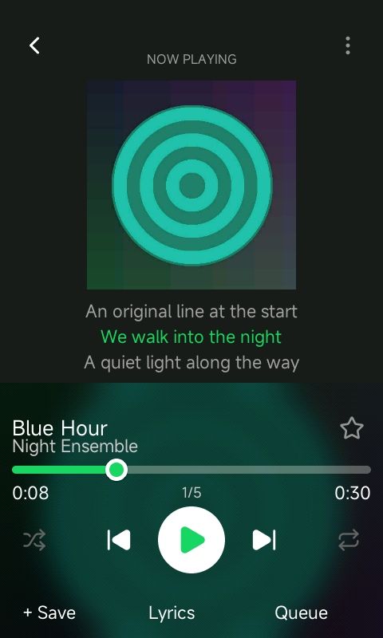
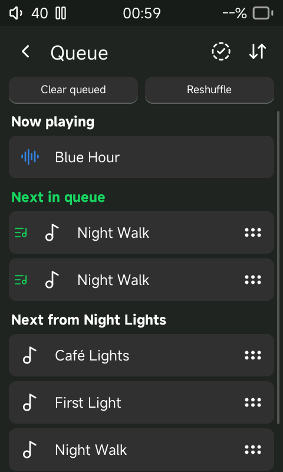
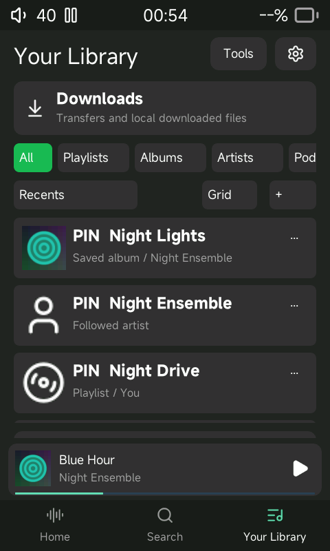

# Offline player integration — 2026-10-28

The native Sonix player now has independent priority/context queues, editable
playlist membership, saved collections and incremental local lyric search.
These are C/LVGL changes in the actual application, exercised in the SDL host
simulator and cross-compiled for the R1 CPU. They are not a flashable firmware
release or a Spotify service integration.

## Using the interface

- Tap the mini-player to open Now Playing. Tap the title for its album and the
  artist for the credited-artist chooser. The overflow sheet also offers album
  saving, artist following/pinning, queue actions and inline-lyrics preferences.
- Shuffle changes upcoming context tracks. Repeat cycles off, context and one
  track independently. Previous restarts after three seconds; near the start it
  walks playback history, including manually queued tracks.
- Swipe right on a song in a native track list or local search result to queue
  it. Queue separates **Next in queue** from **Next from [album/context]**.
  Priority entries have a green queue marker. Clear affects only that section.
  Swipe left removes an upcoming entry; hold its grip to reorder within its
  section. Selection mode offers removal and move-up without crossing sections.
- **+ Save** opens playlist membership checkboxes and an independent Liked Songs
  toggle. Create a playlist there to add the current song immediately. Clearing
  membership removes every duplicate occurrence. Audio files are never deleted
  by these controls.
- Artwork expands on tap; tapping again or swiping down restores it. Inline
  synchronized lyrics use the existing embedded/sidecar lyric reader. Full
  lyrics remain available with inline previews disabled. Unsynchronized text
  is not presented as timed lines.
- Library offers collection filters, four pinned entries, four sort modes and
  persistent grid/list layouts. Playlist rename preserves its pin and dates;
  deletion removes its saved-collection record. Existing playlist editing,
  indexed albums/artists and podcast screens remain reachable.
- Local search updates after 180 ms of idle typing, grouped into Songs, Albums,
  Artists, Playlists and Lyrics, with lyric excerpts. It folds supported accents
  and case and ranks exact/prefix matches. Typing does not initiate an online
  request; online catalog searches remain explicit.

## State and resource bounds

`playlist.c` retains the existing compact context representation and adds a
64-entry priority queue and bounded 128-entry past/future stacks. Priority entries
survive a context change and never become members of a repeated album. Disabling
shuffle restores remaining context tracks to their original relative order.
Selecting another track in the same context preserves its shuffle deal.

With Remember track enabled, `.local/playback-session.db` stores the context
permutation, priority entries, history and active override transactionally.
The existing device state owns position and the context mirror. Restore validates
entry bounds and permutation uniqueness. Its context identity check currently
uses count and first/last paths, so a changed middle section with matching ends
is a remaining limitation. Saving recreates a removed sidecar's order rows.

`.local/collections.db` stores saved status, pin rank, creation/save date and
recent interaction separately from the music files. Collection pages contain
at most 24 entries; eight asynchronous 64-pixel artwork slots serve visible rows.

The existing music database holds `SEARCH_DOC`, `SEARCH_WORD`, `SEARCH_DIRTY` and
`SEARCH_LYRIC_STATE`. B-tree word postings avoid requiring FTS in Sonix's SQLite
build. Each lyric document is capped at 16 KiB and 2,048 token visits. Queries
consider at most 512 postings per category and expose six results per category
in the shell. Broad searches can therefore omit matches; fuzzy matching is not
implemented. Search runs off the UI thread. Scanner/import work indexes lyrics;
Detect changes checks audio and lyric sidecar stamps and rereads changed lyrics.
Existing cards need a scan or Detect changes pass to backfill their lyric index.

## Evidence

- [Queue regression](evidence/priority-test.log): FIFO, shuffle isolation,
  history traversal, context replacement, repeat isolation, reorder/removal,
  session restoration, deleted sidecar recreation and malformed order rejection.
- [Offline library regression](evidence/offline-library-test.log): actual WAV
  scanning, accent/prefix and lyric searches, changed LRC reindexing, membership,
  independent saved albums, four-pin limit, rename/delete metadata and reopening.
- [Import regression](evidence/offline-import-test.log),
  [discovery/TLS sanitizer suite](evidence/offline-discovery-test.log),
  [packaging guard](evidence/offline-packaging-test.log), and
  [target ABI check](evidence/offline-target-abi.log). Final host/target/debug
  binary sizes and SHA-256 values are in [the build record](evidence/offline-builds.json).
- Touch inspection: search results appeared before keyboard submission; swipe
  queueing, handle dragging, bulk move-up and removal changed the actual queue.
  Playlist membership, artist chooser, inline/full lyrics and all four layouts
  were captured. These checks do not certify physical buttons or DAC output.

| Now Playing | Priority queue | Library |
|---|---|---|
|  |  |  |

Additional captures: [instant search](screenshots/offline-instant-search.png),
[typing](screenshots/offline-instant-search-typing.png),
[playlist membership](screenshots/offline-playlist-membership.png),
[full lyrics](screenshots/offline-full-lyrics.png), and
[expanded artwork](screenshots/offline-artwork-expanded.png).
Fixture artwork, track names and lyric lines are original synthetic test data;
the five fixture WAV files are silent.

## Remaining acceptance work

The supplied Figma file was not accessible in this session, so exact visual
matching is unverified. The written interaction specification guided this work.
There is no configurable smart-playlist editor, custom playlist artwork picker,
hybrid Downloaded filter, local similarity autoplay or Fewer Repeats mode yet.
Podcast saving/pinning is not wired into the new collection panel; its existing
followed-show and episode resume screens remain available. Artist credit splitting
uses Sonix's metadata indexing settings. Only the shell tab is persisted, not an
arbitrary nested screen stack. A standalone priority-only queue is runtime-tested;
boot restoration without a base context is not covered. Collection metadata and
playlist rename live in separate databases and are not one atomic transaction.

Large-library latency, SD wear, power loss, card removal during these new writes,
whole-system RAM, prolonged playback and the physical R1 remain unverified.
The latest-board compatibility guard remains in place; no update image or flash
operation is included. See the broader [acceptance ledger](feature-matrix.md).
