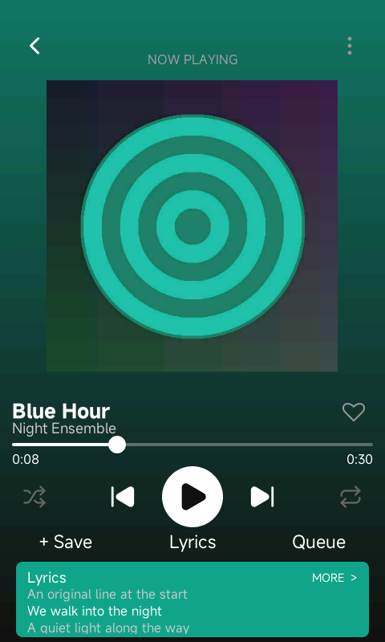
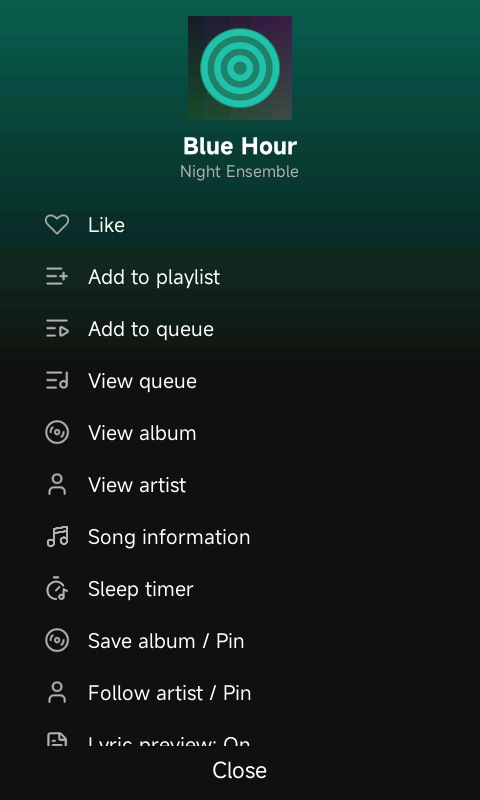
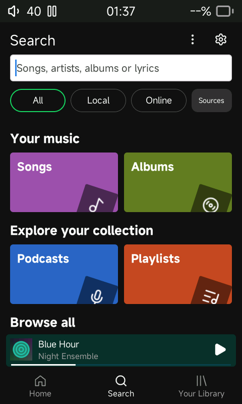
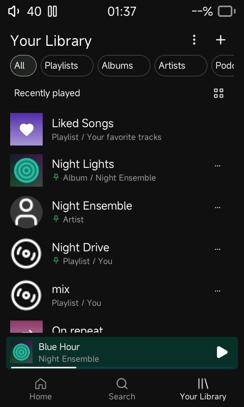
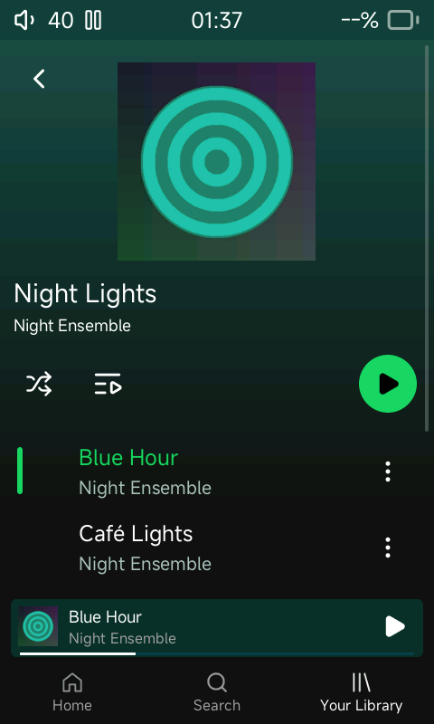

# Screenshot-based UI update

The subsequent [sliding-panel update](sliding-panels.md) supersedes the earlier
heart control, full-page queue/menu, and artist browsing descriptions below.

The four supplied mobile screenshots guided this native 480 × 800 LVGL update.
Colors follow local artwork and the content comes from the indexed card.

- **Now Playing:** larger artwork, an artwork-colored gradient, white transport
  and seek controls, an outline/filled Like heart, smaller time labels, and a
  colored Lyrics card. The card opens full lyrics; its preview respects the
  saved preference. Missing local lyrics have an explicit empty state.
- **Song menu:** a full-screen view with cover thumbnail, title/artist, icon-led
  actions and a fixed Close control. Like, playlist membership, queue, album,
  artist, song information and sleep timer use existing native actions. Additional
  offline options are reachable by scrolling. The menu owns a bounded 104-pixel
  cover copy and closes on track refresh to avoid stale image references.
- **Search:** white search field, compact scope chips and colorful two-column
  browse tiles. Up to two indexed genres appear when available; otherwise Songs
  and Albums lead the page. Tiles open actual local collections or service pages.
- **Library:** flat rows, outlined filters, Liked Songs artwork, circular artist
  placeholders, small green pin indicators, a grid/list icon and header plus.
  Downloads remains in the scrolling collection list.
- **Albums:** a smaller centered sleeve, left-aligned metadata, green play
  control, compact rows with artist subtitles and green playing-track text.
  The existing mini-player and navigation widgets are shared with the album
  screen, so transport state stays synchronized without another playback owner.
- **Navigation:** Home and Library now use dedicated outline icons. The
  mini-player has a compact artwork-colored surface and a white progress line.
  The header ellipsis opens the existing Tools destinations.

| Now Playing | Song menu |
|---|---|
|  |  |

| Search | Library | Album |
|---|---|---|
|  |  |  |

These are actual SDL captures using original synthetic artwork, lyrics and
silent WAV fixtures. Touch targets and scrolling are adapted to the R1 display;
the reference's streaming-only actions are not represented by inactive controls.
Saved settings still govern the alternative album header and player layout.

Host and MIPS target builds pass without compiler warnings; the target still
passes the glibc 2.22 import ceiling. [Build hashes](evidence/reference-builds.json),
[queue regression](evidence/reference-priority-test.log),
[library regression](evidence/reference-library-test.log), and
[ABI output](evidence/reference-target-abi.log) record the checks.

Twelve scripted album/mini-player/navigation cycles completed without process
exit: [navigation observation](evidence/reference-navigation.json). A separate
fresh-card smoke check verified provider preference persistence, four navigation
cycles and the Downloads route: [smoke output](evidence/reference-smoke.log).
The reference fixture peaked at 41,024 KiB host RSS in that navigation sample;
this is not an R1 whole-system RAM measurement. Instant local results were also
visually checked before keyboard submission. Standard, Waveform and Studio were
inspected after the new styling; Studio's background was corrected during review.

The previously documented hardware and packaging restrictions remain unchanged.
This update does not provide a flashable image or claim physical-device validation.
