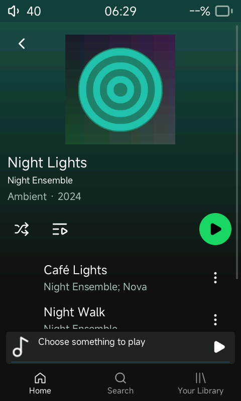
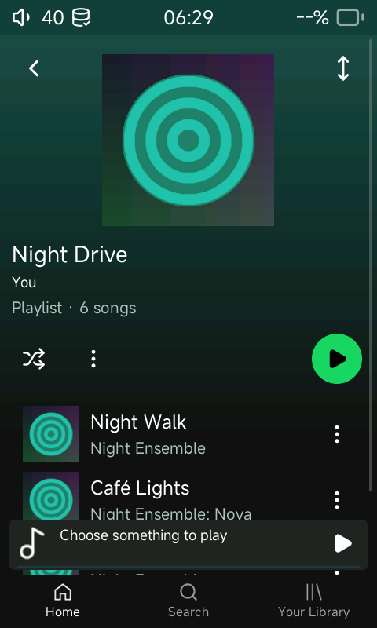

# Shared album and playlist page

Playlists now use `medialist`, the same C/LVGL renderer as albums. Both present a
centered 220 px cover, bounded title, artist/creator, metadata, shuffle and green
play controls, scrolling track rows, and the shared mini-player/navigation.
Playlist artwork comes from its first track; absent artwork uses the existing
lightweight release placeholder. Albums retain track/disc numbering; playlists
retain track thumbnails because a playlist can span releases.
Liked Songs also uses the collection header and retains its permanent identity
and independent liked membership; it cannot be renamed or deleted.

The playlist ellipsis opens its management sheet: Add songs, Edit tracks, Add to
queue, Move to folder, Rename, Delete, and pin/custom-order actions. Edit uses
the existing drag handles; the corner reorder control exits that mode. Track
menus provide removal. The empty collection keeps its header and menu, dims
unusable transport, and explains how to add songs. Metadata/artwork refresh after
edits; deleting the open playlist returns to the main screen without deleting
audio. Add songs replaces sheet content without dropping the overlay.

The separate playlist browsing renderer, timer and four artwork slots have been
removed. Track widgets remain a pool of twelve, with windowed metadata and an
indexed track-ID list. A 257-entry playlist does not create 257 row widgets.

## Reproduce native verification

From WSL, after the host build:

```sh
python3 tools/test_ui_collections.py /home/justi/sonix-r1-build
```

The harness requires the build's existing SDL/FFmpeg libraries plus Python Pillow,
Xvfb, xauth, xdotool and ImageMagick. It generates original silent FLAC files,
embedded artwork, missing-art releases, structured collaboration credits, dated
albums/single/EP, long metadata, LRC lyrics and four playlists through the real
library APIs. It owns a private X display; it does not drive the user's desktop.

`artifacts/ui-collections-*/report.json` records checks, actions, captured images,
live LVGL tree/playback state and host performance. `SONIX_UI_PROBE_DIR` enables
the local host-only diagnostic channel; the device build has no such input.
Setup commands open fixtures. User actions use SDL mouse events, including taps,
long-held row dragging, vertical scrolling, sheet-handle dismissal and rapid taps.
SQLite reads independently confirm playlist order and membership.

For an approved static baseline directory, add `--baseline /path/to/baselines`.
Normalized images mask only the status bar; dynamic playback captures remain
evidence and are excluded from pixel matching. Baseline files are read-only to
the harness. No screenshots in this change are claimed as approved baselines.

See the test matrix and decision log for verification results and limitations.

## Inspected native captures

| Album | Playlist |
| --- | --- |
|  |  |

[Long title](screenshots/shared-playlist-long.png),
[empty playlist](screenshots/shared-playlist-empty.png),
[drag editing](screenshots/shared-playlist-edit.png),
[after adding a song](screenshots/shared-playlist-added.png), and
[Liked Songs](screenshots/shared-liked-songs.png).

Machine-readable evidence: [full journey](evidence/shared-collections-ui.json)
and [targeted empty collection](evidence/shared-liked-ui.json). These are
development verification artifacts, not device certification or approved baselines.
