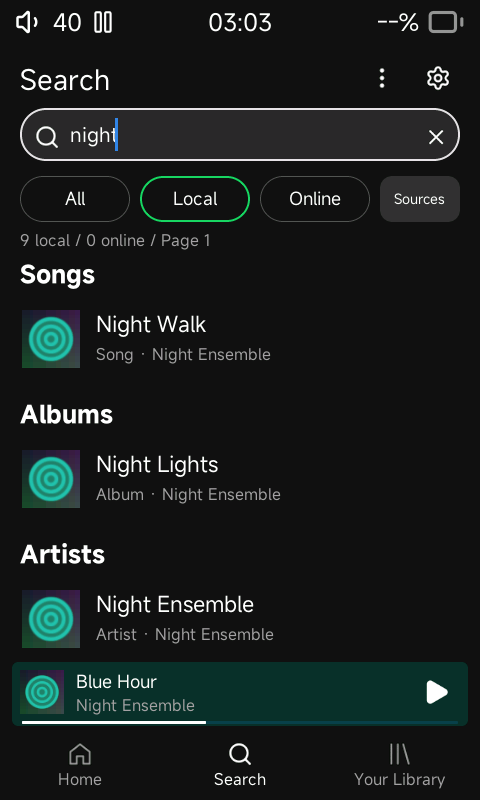
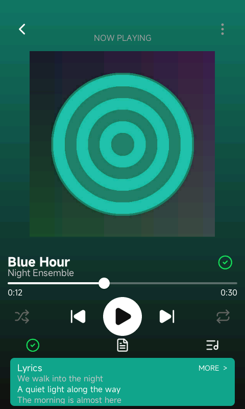
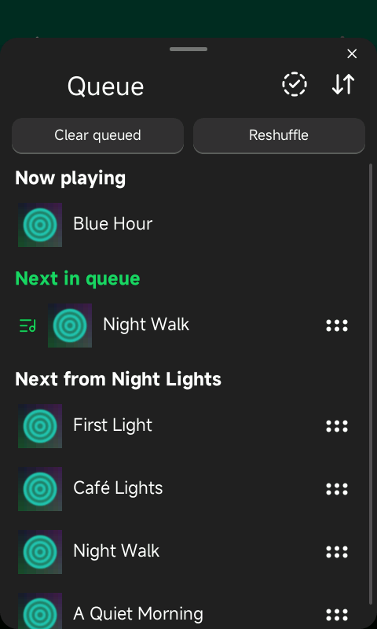
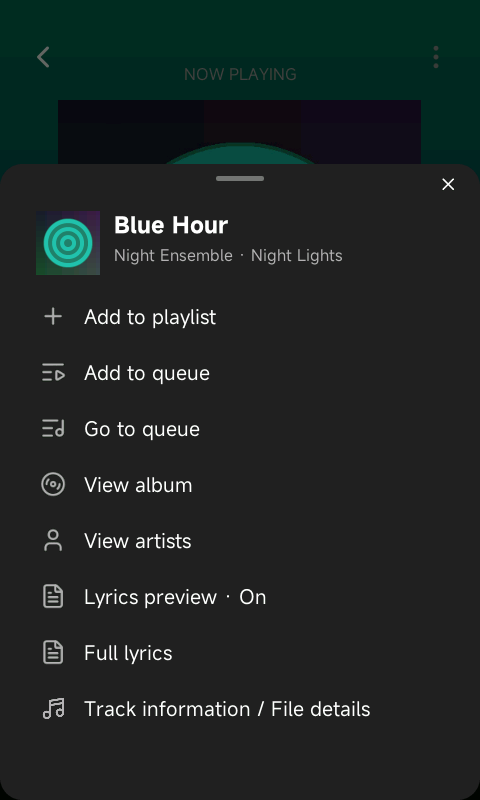
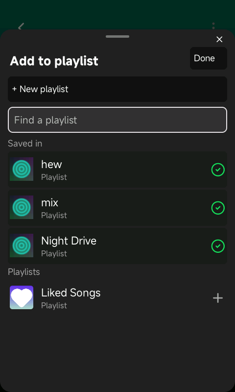
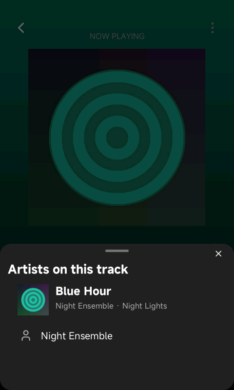
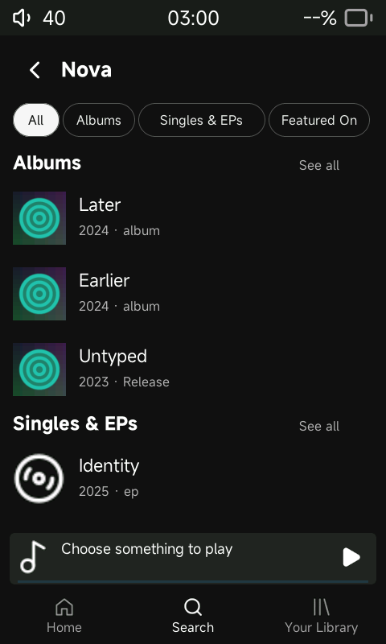
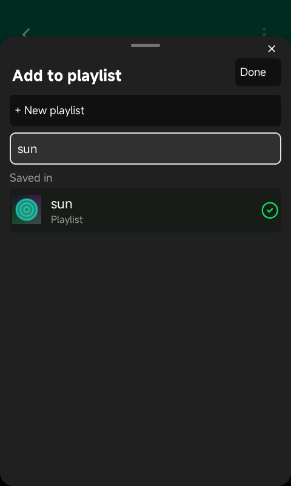

# Sliding panels, visual search and local discography

This update follows the supplied search, Now Playing, queue, playlist and artist
references in the native 480 x 800 LVGL simulator.

## Interaction changes

- Search uses a rounded dark field with a magnifier and clear control. Local
  song, album, artist and playlist results use available release artwork from
  the card, with neutral fallbacks. Decoding stays on the cover worker.
- Now Playing has icon actions for playlist membership, lyrics and queue.
  The title-adjacent save control shows a green check when the song belongs to
  any playlist, including Liked Songs, and opens the membership picker directly.
  The [Home/player update](home-dashboard.md) removes the duplicate bottom save
  control and places lyrics and queue at opposite sides beneath transport.
- Queue, song options, playlist membership and artist selection share one modal
  layer. Entry/exit animate vertical position and scrim opacity for 220 ms.
  Replacement flows keep the same layer without briefly exposing the player.
  Close, outside tap and downward handle drag dismiss the sheet. Content
  scrolling and queue-item dragging do not dismiss it.
- The queue retains the bounded native editor, manual-priority and context
  sections, clear-priority, reordering, swipe removal, selection and Move Up.
  Visible rows load covers asynchronously. Borrowed queue widgets return to
  their original page when the sheet closes.
- The playlist picker has search, selected/unselected groups, green checks and
  thumbnails. Liked Songs participates in the same picker. Changes persist
  immediately; Done closes the picker. Creation uses a nested name-entry view,
  adds the track, and returns with the new playlist selected and its name in
  the filter. Cancel returns without creating it. Liked Songs is a reserved name.
- Song options show a cover/title/artist header and local actions. Add to queue
  closes the panel; Add to playlist and View artists replace its content.
  Artist selection shows the song/release reference and separate performers.
  Song menus retain their snapshot if playback advances.

## Discography metadata

Artist pages contain only All, Albums, Singles & EPs and Featured On. All shows
three sections with up to four releases each and See all controls; individual
filters page through twelve releases. Releases sort newest first using full
release dates, falling back to years. Selecting a release opens its existing
artwork/track/playback page. No artist photographs, biography or rankings are
requested or stored.

The scanner persists release dates, types, owners and explicit credits alongside
the music index. Old indexed tracks are backfilled through the normal card-return
change scan. Views refresh when the library revision changes.

Tag names follow the [MusicBrainz Picard mapping](https://picard-docs.musicbrainz.org/en/latest/appendices/tag_mapping.html):
Vorbis/APE release types and credits, ID3 custom fields including MusicBrainz
Album Type/Artist Id/Album Artist Id and ARTISTS, and supported MP4 freeform
fields. MP4 dates retain the full date instead of only the year. Fields and
credit counts are bounded; discography queries read no audio files.

ALBUMARTIST determines ownership. Aligned MusicBrainz identifiers take precedence
when comparing performer and release-artist identity. Explicit ARTISTS credits
can establish featured appearances when IDs are absent. Ambiguous display-name
strings are not split on guessed phrases such as "feat." to fabricate credits.
A missing release type stays in Albums as **Release**, including one-track
releases; it is never guessed to be a single. Missing or ambiguous tags can
omit featured appearances until the files are tagged and rescanned. Existing
name-based artist navigation still groups identical display names.

## Validation

Host and MIPS builds and the glibc 2.22 ABI check pass. Native queue and library
regressions pass. The discography harness imports original silent FLAC and MP3
fixtures and checks full-date ordering, ID3 multivalue credits, explicit single/EP
classification, unknown types, conservative featured classification, MusicBrainz
identity matching, separate artist choices, paging and persistence.

SDL checks exercised nested creation, menu-to-picker transitions, artist/release
navigation, queue dragging and swipe removal, and downward handle dismissal.
Playback advanced from 0:09 to 0:12 across queue opening and dismissal. These are
simulator observations, not physical R1 timing measurements.

Evidence: [discography](evidence/sheets-discography-test.log),
[queue](evidence/sheets-queue-test.log), [library](evidence/sheets-library-test.log),
[ABI](evidence/sheets-target-abi.log), [builds](evidence/sheets-builds.json).

| Search | Now Playing | Queue |
|---|---|---|
|  |  |  |

| Song options | Playlist picker | Artist selection |
|---|---|---|
|  |  |  |

| Discography | Featured On | New playlist selected |
|---|---|---|
|  |  |  |

Hardware validation and packaging remain subject to the existing
[hardware restrictions](hardware-and-packaging.md). This is not a flashable image.
